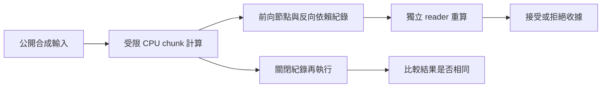

# 小麥如何把改變接到可核對的證據

小麥的目標是讓 AI 能檢查自己的理解和方法，發現失效原因，再提出、驗證並保留改變。要檢驗這種能力，需要同時看到「它提出了什麼」與「程式實際做了什麼」。文字說明不能替代後者。

目前公開程式聚焦兩段工程流程：運算紀錄的獨立重算，以及更新狀態的保存與接續。自主形成研究問題、提出新機制與選擇實驗的能力，仍需要另外驗證。

## 公開運算追蹤

`src/chunk_training/` 實作這個示範使用的 chunk 計算。`src/xiaomai_trace/` 記錄標量運算、輸出與最後狀態的共同梯度來源，以及反向依賴中的累加；零梯度貢獻也需要留下。

每筆事件有順序與 hash chain。hash 用來檢查紀錄身分、順序與完整性；reader 還會重算數值及局部導數，不能只靠 hash 宣告算術正確。對已有見證的核對需要保留原接受收據的最後 hash；把一份錯誤紀錄重新串成自洽的 hash chain，不會因此成為原見證。

可直接核對[本次合成計算圖](../evidence/public_trace_20261003/COMPLETE_SCALAR_GRAPH.jsonl)及[獨立讀回結果](../evidence/public_trace_20261003/RESULT.json)。這份圖只有指定小型合成輸入，不是完整模型或私人 True 資料。

示範也比較開啟、關閉紀錄後的輸出、狀態及梯度，檢查本次記錄行為是否改變結果。這不保證任意外部 observer 都沒有副作用。

紀錄寫入失敗、超出限額或來源在執行中改變時，應留下不完整標記與失敗原因。不能把半份紀錄當成成功接受。

### 追蹤到什麼程度

這裡追蹤的是指定 CPU FP32 chunk 的標量計算圖。NumPy 配置與轉型、Python runtime、部分數學函式仍是外部邊界；不是整個模型的所有 Python opcode，也不是 GPU 硬體指令。

運算一致性與「模型為何選擇這個答案」也屬於不同問題。看到某個參數、節點或梯度參與運算，只能建立可追查的依賴。若要判斷它是否造成錯誤，還需要受控介入、消融、反例及與替代解釋的比較。

## 公開更新與保存示範

`examples/run_lifecycle_demo.py` 使用 1,342 個合成模型參數，其中 412 個可訓練。它沿用 PythonTape 與 PythonAdamW 計算研究更新，forward 仍使用原生運算。更新前後的參數與 optimizer 狀態寫入保存點，再由另一個程序恢復並對照下一步輸出、更新、optimizer 與隨機狀態。這讓審查者檢查保存接續的基本契約，不需要私人模型權重。

這段原有示範所需的固定來源放在 `vendor/lifecycle_source/`，與輕量 trace 入口的依賴分開。摘要收據明示合成資料、參數規模與原生 forward 邊界。

這個示範與既有 True 整合使用不同的執行規模。True 的最新工作接續既有模型保存點，研究分支使用 PythonTape 及 PythonAdamW；凍結底座特徵計算與 policy sampling 仍使用原生 Torch CPU。原任務、候選與工具觀察由 host 固定，因此該流程支持更新與接續的工程結論，尚不能支持自主研究能力的結論。

## 接下來要接上的能力

預期研究循環是：

1. 系統在執行中發現觀察與自身預測矛盾。
2. 沿運算、假設與資料的依賴找出可能失效的位置。
3. 提出新的表示、機制或問題定義，預先寫下可被推翻的預測。
4. 用反例、介入及消融實驗比較新舊解釋。
5. 只有有效改變才保留，經保存與新程序恢復後，再檢驗它能否用在新問題。

這裡的「可解釋」要求改變理由能接回實際證據，而不是只輸出一段自我反省文字。消融能幫忙定位因果作用，也可能因元件冗餘、交互作用或分布改變而誤導；不能保證一次拆解就找到所有根因。

這個循環是研究目標。公開 CPU 示範目前驗證其部分工程元件，完整能力的實驗設計見[下一個能力實驗](next_experiment.md)。
