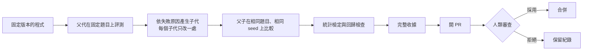
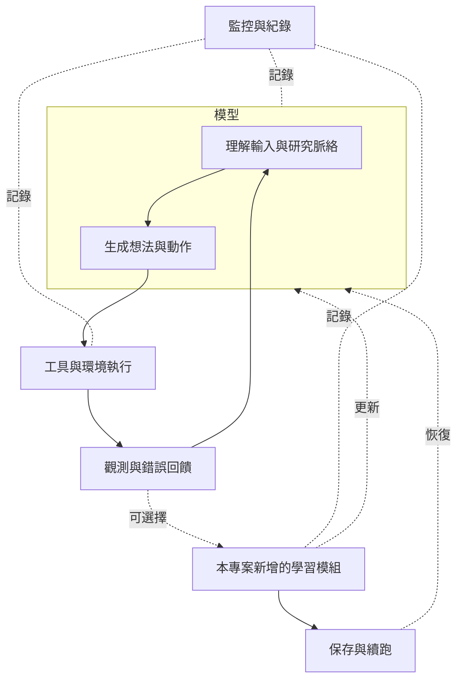

# 系統設計概念

整理日期：2026-10-10。

本頁用概念圖說明小麥的兩個系統怎麼運作、遵守哪些原則。具體實作、參數與模組設計不在公開範圍，可於學術審查或合作討論時說明。

## 一、驗證板與有限度的自我演化

這不只是一個 AI agent，而是**一塊驗證板，加上一個受限制的演化迴圈**。設計要求是：系統可以提出改進，每一次改進都要附上證據，最後由人決定是否採用。

### 評分方式

分數同時看**答對多少**和**信心準不準**。一個模型如果答錯卻很有把握，會被扣分；這是為了鼓勵模型知道自己不知道什麼。

### 安全原則

以下是驗證板的設計規則；依原研究 repo 的說明與測試，已在驗證板的程式與工作流程中實作。它們不代表完整 True 模型的所有候選與內部運算，都已經過同樣的隔離或追蹤驗收。

- 模型產生的程式碼一律放在**斷網、唯讀、有資源上限**的沙盒中執行。
- 演化只能改指定的設定，**不能修改評分器、題庫、工作流程或沙盒本身**。
- 每次正式執行都需要一張短期授權，綁定程式版本、預算和時限。
- 系統可以開 PR，但**沒有合併權限**。
- 題目分成三種用途：搜尋用、只能否決不能晉升用、未來外部保留用。保留題不放在 repo 裡。

## 二、研究循環：模型、工具、觀測與學習

- **實線**是每回合都會走的資料流，**虛線**是可選擇的學習與狀態流。
- 「記錄」是設計要求：目前已能記錄指定的運算、更新與保存；完整 True 內部運算的全面追蹤尚未驗收。
- 底座是開源模型 ORNITH-1.5-9B；本專案新增的部分和原版分開記帳，避免把上游功能算成自己的成果。
- 「有更新入口」不等於「模型已經學會反思」。這是要用實驗回答的問題，不是設計就能保證的。

## 三、證據的原則

整個專案共用同一套證據規則：

1. **分母先於結果**：先寫跑了幾次、成功幾次、失敗幾次，再談結論。
2. **失敗不改寫**：失敗紀錄原樣保留，修正後另開新紀錄，不覆蓋舊的。
3. **身分可核對**：程式、資料、保存點都用雜湊值綁定。
4. **主張有邊界**：每份報告都寫明「這個結果不能推論什麼」。
5. **作者與模型分開**：人寫的程式和修補，不算成模型的自主成果。
